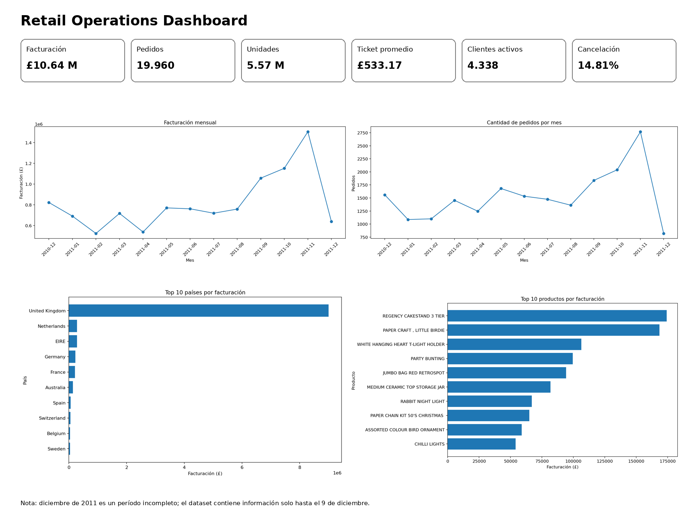

# Retail Operations Dashboard

Proyecto de análisis de operaciones construido a partir del dataset **Online Retail**.

El objetivo es transformar una base de más de 500 mil registros en indicadores y visualizaciones que permitan monitorear el desempeño de una operación de ventas.



## Herramientas

- Python
- pandas
- NumPy
- Matplotlib
- Power BI
- DAX

## Dataset

La base original contiene **541,909 registros** y 8 columnas.

Período disponible:

- Inicio: 2010-12-01
- Fin: 2011-12-09

Diciembre de 2011 es un período incompleto, ya que los datos terminan el 9 de diciembre.

## Preparación de datos

El proceso considera:

- Eliminación de **5,268 duplicados exactos**.
- Identificación de facturas canceladas.
- Identificación de cantidades negativas.
- Exclusión de precios no positivos de las ventas válidas.
- Creación de variables temporales.
- Cálculo del importe por línea.
- Preparación de una base específica para Power BI.

Una venta válida debe cumplir:

1. La factura no comienza con `C`.
2. La cantidad es mayor que cero.
3. El precio unitario es mayor que cero.

## KPI principales

| Indicador | Resultado |
|---|---:|
| Facturación total | £10,642,110.80 |
| Pedidos | 19,960 |
| Unidades vendidas | 5,572,420 |
| Ticket promedio | £533.17 |
| Clientes activos identificados | 4,338 |
| Tasa de cancelación | 14.81% |

## Principales hallazgos

- **Noviembre de 2011** presenta la mayor facturación del período, con aproximadamente **£1,50 millones**.
- En noviembre también se alcanza el mayor volumen de pedidos, con **2.769 pedidos**.
- El crecimiento entre septiembre y noviembre está asociado principalmente a un mayor volumen de operaciones.
- Reino Unido concentra aproximadamente **84.6%** de la facturación de ventas válidas.
- Diciembre no se interpreta como una caída real porque el período está incompleto.

## Estructura

```text
retail-operations-dashboard/
├── analisis_operaciones.py
├── retail_operations_dashboard.ipynb
├── requirements.txt
├── README.md
├── datos/
│   ├── Online Retail.xlsx
│   └── retail_operaciones_powerbi.csv
├── powerbi/
│   ├── GUIA_POWER_BI.md
│   └── medidas_dax.txt
└── resultados/
    ├── dashboard_operaciones.png
    ├── 01_facturacion_mensual.png
    ├── 02_pedidos_mensuales.png
    ├── 03_ticket_promedio_mensual.png
    ├── 04_top10_paises_facturacion.png
    ├── 05_top10_productos_facturacion.png
    ├── 06_tasa_cancelacion_mensual.png
    ├── kpis_resumen.csv
    ├── resumen_mensual.csv
    ├── cancelaciones_mensuales.csv
    ├── top10_paises.csv
    └── top10_productos.csv
```

## Ejecutar el proyecto

Instalar dependencias:

```bash
pip install -r requirements.txt
```

Ejecutar el script:

```bash
python analisis_operaciones.py
```

O abrir:

`retail_operations_dashboard.ipynb`

## Power BI

La carpeta `powerbi` contiene:

- Las medidas DAX del dashboard.
- Una guía para importar el CSV limpio.
- Los tipos de datos y gráficos recomendados.

El archivo preparado para Power BI es:

`datos/retail_operaciones_powerbi.csv`
